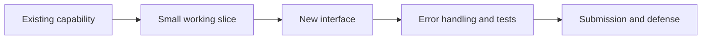

# Assignment intake and learning map

Use this reference when a new assignment, updated specification, or unfamiliar repository arrives.

## Build an evidence based requirement map

Read the entire brief, including examples, error cases, submission format, and bonus labels. Inspect relevant project files if accessible. Record:

| Item | What to capture |
| --- | --- |
| Required behavior | Observable result, input, output, edge cases |
| Constraints | Language, libraries, architecture, environment, deadlines if supplied |
| Interfaces | Routes, CLI flags, file formats, data contracts, UI actions |
| Verification | How the learner can demonstrate each requirement |
| Learning prerequisite | Concept they need before implementing it |
| Unknowns | Missing brief, ambiguous wording, absent dependency, untested assumption |

Separate **mandatory**, **optional/bonus**, and **suggested implementation**. A sample folder tree, algorithm, or code fragment may illustrate an approach rather than mandate it; follow the wording of the brief. Do not turn a sample into a fixed requirement without evidence.

If a requirement conflicts with another part of the brief, identify the conflict and ask the learner to check the authoritative source when it changes the implementation. Otherwise make a reversible assumption and label it.

## Diagnose with minimal friction

Ask for prior work and use a small probe rather than a broad self-rating. Choose up to three questions tied to the next milestone, such as:

- “Что произойдёт, если клиент отправит `POST` на route, который принимает только `GET`?”
- “Где сейчас находится логика генерации и как её можно вызвать из HTTP handler?”
- “Как ты проверишь, что ошибка пришла из backend, а не из `fetch`?”

Accept code, an explanation, a drawing, or terminal output as evidence. Record what is demonstrated, what is uncertain, and the smallest useful next exercise. Reassess when new evidence appears; never freeze the learner into an initial level label.

## Sequence by dependencies

Create a map of concepts and deliverables, then choose a vertical slice that can be run or observed. Prefer a path where one concept unlocks the next. For a web task this may mean server response before form handling, a local JSON endpoint before frontend `fetch`, and mock behavior before an external API call. Treat this as an example, not a rule for every project.

Use Mermaid only when it clarifies relationships. Keep diagrams small enough to read and correct for the assignment. A useful template:

In the first response to a large brief, present a brief requirement summary, a dependency map, an initial diagnostic or mini-task, and the next step. Keep the full plan available, but teach one milestone at a time.

