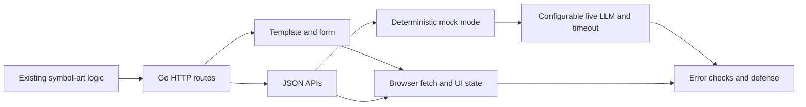

# Worked intake example: `symbol-web`

This reference is an example derived from the supplied Tomorrow School `symbol-web` brief. Re-read the learner's actual version when coaching; its wording and repository are authoritative. Do not copy this plan into another assignment.

## Requirement and concept map

| Required behavior | Concepts to learn | Evidence to request |
| --- | --- | --- |
| `GET /` renders a page with text, banner choice, and result area | Go `net/http`, routing, `html/template` | Browser response and explanation of template data |
| `POST /symbol-art` converts text using `shadow`, `standard`, or `thinkertoy` | Forms, validation, reuse of existing ASCII generator | Three banner cases plus invalid/empty input |
| `POST /api/suggest` returns 3–5 completions for input of at least 3 characters | JSON contract, mock/live modes, outbound request, timeout | Deterministic mock result and graceful 10-second timeout behavior |
| `POST /api/recommend-banner` uses explainable rules only | Text profiling, deterministic branching, JSON response | Repeatable result and reasons for multiple input classes |
| Frontend requests suggestions and recommendations | `fetch`, async handling, debounce, loading/error UI | Typing waits about 300 ms, selection fills input, errors stay visible |
| Configuration and submission | Environment variables, `.env.example`, README, tests | Mock run without key; configured live path; documentation and checks |

Bonus work: `POST /api/variations` and response caching. Teach and implement after mandatory behavior works, if the learner wants to pursue them. The sample directory structure and sample rules in the brief are useful guidance; verify whether their exact form is mandatory before enforcing it.

## Dependency map

## Good opening diagnosis

Ask for their `symbol-art` repository or a description of its public function, then choose one or two probes:

1. “Как `POST /symbol-art` получит `text` и `banner`, и где проверишь их до генерации?”
2. “Почему `recommend-banner` должен работать без сети, а `suggest` может ждать внешний сервис?”
3. “Что должен увидеть пользователь, если LLM не ответит за 10 секунд?”

If they cannot answer, teach the minimum concept and give a small trace exercise. If they already have handlers, inspect those and move to the first unverified requirement.

## Suggested small milestones

1. Map existing ASCII generator inputs, outputs, and errors; run one CLI case. Do not rewrite it yet.
2. Make `GET /` serve a simple template and explain the HTTP request/response path.
3. Make the form reach `POST /symbol-art`; validate input and call the existing generator.
4. Define JSON request/response contracts, then implement deterministic `recommend-banner` rules.
5. Implement `suggest` in mock mode first. Check minimum input length, 3–5 responses, and determinism.
6. Add live LLM configuration (`LLM_BASE_URL`, `LLM_MODEL`), 10-second timeout, parsing, and graceful failure. Treat API specifics as dependent on the selected backend; do not invent its response schema.
7. Add frontend `fetch`, 300 ms debounce, loading and error states, and click-to-fill.
8. Verify mandatory cases, `.env.example`, README, tests, then rehearse the defense. Consider `variations` and caching afterward.

At each milestone, give one practice task and await the learner's attempt. For instance, before coding the form handler, ask them to draw: `browser form → POST body → handler validation → generator → response`. Ask what status and UI message should result from an invalid banner.

## Common discussion points for defense

- How the same core generator is reused by CLI and web entry points.
- Why `recommend-banner` is rule based and deterministic, while `suggest` can call an LLM.
- What mock mode proves, and what still needs a live backend test.
- Where timeout, response validation, and HTTP status decisions occur.
- How debounce and asynchronous `fetch` affect frontend behavior.

